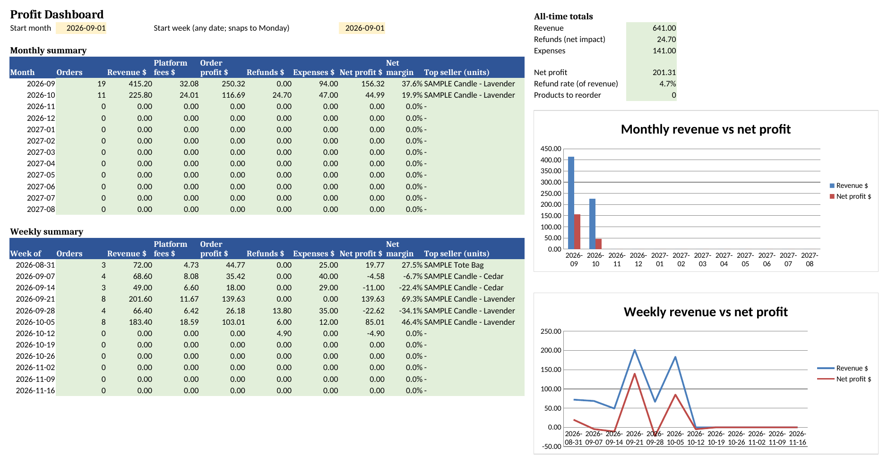

# Side Hustle Profit Tracker — FREE Lite

A free, 2-tab Excel / Google Sheets starter for side hustlers and small sellers who need a quick monthly profit number—not full accounting software.

This repository hosts the **FREE Lite** preview only. The complete tracker (inventory, refunds, expenses, weekly view, charts, and more) is sold separately.

**Full version:** [YOUR_GUMROAD_URL](YOUR_GUMROAD_URL)

## What's in FREE Lite

- **Orders** — log about 30 sample-sized order rows (channel, product, qty, fees)
- **Dashboard** — monthly revenue, platform fees, and profit from those orders
- Works in **Microsoft Excel 2010+** (Windows / Mac) and **Google Sheets** (File → Import)
- Standard spreadsheet formulas only — no macros, VBA, or add-ons

## What's in the full tracker (paid)

- Dashboard with 12-month and 12-week views, charts, refund rate, reorder counts
- Orders (500 rows), Products, Stock In, Refunds, Expenses, Settings
- Channels for Etsy, Shopify, Amazon, eBay, Stripe, offline, and custom fee slots

Get the full file: **YOUR_GUMROAD_URL**

## How to use

1. Download [`templates/Side-Hustle-Profit-Tracker_FREE-Lite.xlsx`](templates/Side-Hustle-Profit-Tracker_FREE-Lite.xlsx)
2. Open in Excel, or in Google Sheets use **File → Import → Upload**
3. Replace the sample rows with your own sales
4. Check the Dashboard for revenue, fees, and profit

## License

- Source files in this repo (README, docs) are under the [MIT License](LICENSE).
- The FREE Lite spreadsheet is provided for **personal and internal business use**. You may fork and adapt it for yourself. Please do **not** resell or redistribute the `.xlsx` as a paid product.
- The full commercial tracker is sold separately and is **not** included here.

## Disclaimer

This is a bookkeeping aid, not tax, legal, or accounting advice. Platform fee examples may be outdated—enter your own current rates.

## Author

Maintained by **Jacketch**. Questions about the paid product: use the contact option on the Gumroad page once live (link above).
